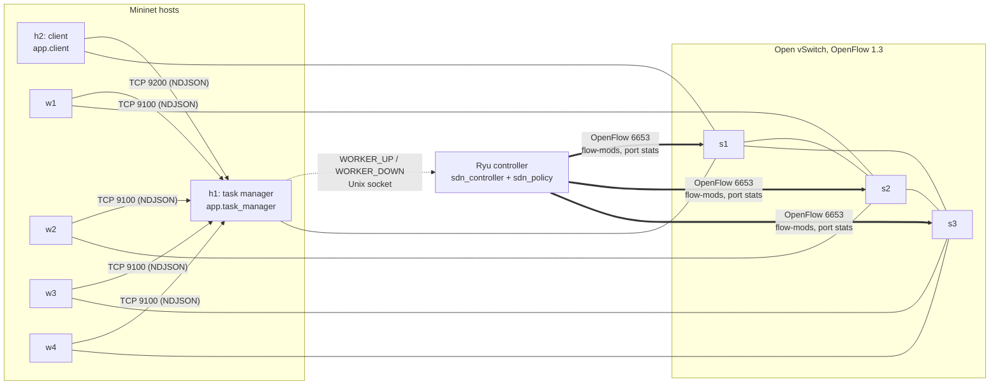
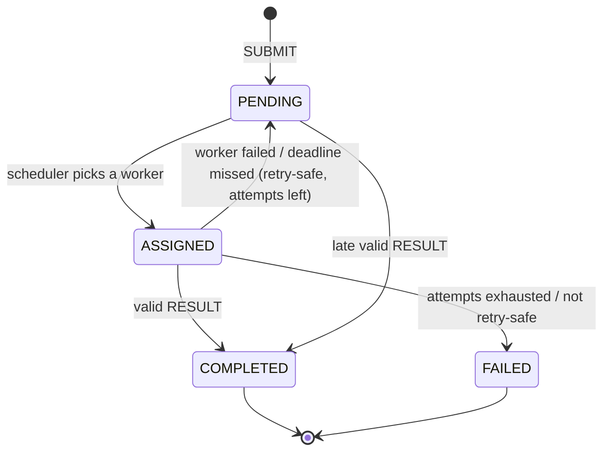
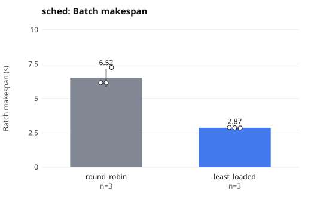
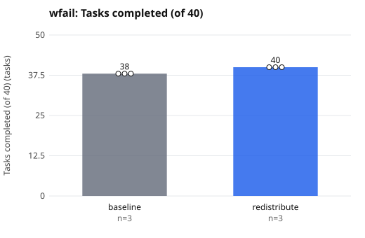
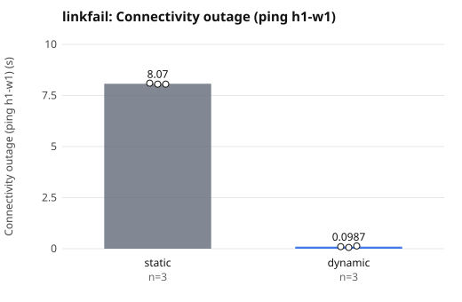
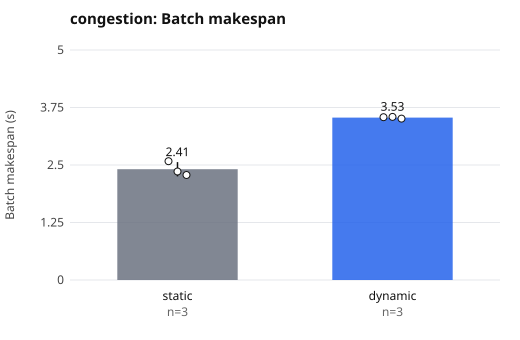

# Distributed Task Notification and Worker System

A distributed task-processing system built on **TCP sockets** and run over a **software-defined network**
(Mininet + Open vSwitch + a Ryu OpenFlow 1.3 controller). A task manager hands tasks to registered
workers, tracks their load, detects failed workers and redistributes their work, while the SDN
controller reacts to link failures, congestion and application events by rewriting flow tables.

Computer Networks mini-project ("CN Jackfruit"). Every number in this document comes from files
committed in `results/`; nothing is estimated.

---

## Contents

1. [Problem statement and objectives](#1-problem-statement-and-objectives)
2. [Architecture](#2-architecture)
3. [Application layer: TCP protocol, scheduling, failure recovery](#3-application-layer)
4. [Network layer: Mininet, Open vSwitch, Ryu](#4-network-layer)
5. [Experiments and results](#5-experiments-and-results)
6. [Limitations and honest caveats](#6-limitations-and-honest-caveats)
7. [Setup](#7-setup)
8. [Running the system](#8-running-the-system)
9. [Reproducing the experiments](#9-reproducing-the-experiments)
10. [Tests](#10-tests)
11. [Project structure](#11-project-structure)
12. [References](#12-references)

---

## 1. Problem statement and objectives

Distributed task systems usually treat the network as a black box. When a link fails or saturates,
the application only sees timeouts. This project builds a small task-distribution system and an SDN
controller that cooperate:

* the **application** (task manager, workers, client) distributes work over TCP and survives
  worker failure;
* the **network** is programmable: a controller installs flows, reroutes around failed links and
  moves application traffic away from congested links;
* the two layers are **integrated**: the task manager tells the controller when workers join or
  leave, so the controller can install per-worker application flows and quarantine dead workers.

Objectives (all implemented; see [section 5](#5-experiments-and-results) for measured evidence):

| Objective | Where |
|---|---|
| Worker registration, task assignment, workload tracking | `app/task_manager.py`, `app/worker.py` |
| Timeouts, failure detection, redistribution | `app/task_manager.py` |
| Scheduling policies with an evaluation against a baseline | `app/scheduler.py`, scenario `sched` |
| A real SDN-controlled network | `topology/topo.py`, `controller/` |
| Dynamic SDN behaviour (reroute, steering, app events) | `controller/sdn_policy.py`, `controller/sdn_controller.py` |
| Reproducible experiments with baselines | `experiments/`, `results/` |

---

## 2. Architecture



Topology (`topology/topo.py`): `h1` (manager) and `h2` (client) on `s1`; `w1`, `w2` on `s2`;
`w3`, `w4` on `s3`. The three switches form a triangle. The core links `s1-s2`, `s1-s3`, `s2-s3` are
**10 Mbit/s** (`TCLink`) so congestion is easy to create; the `s2-s3` link is the backup path.
Hosts use `10.0.0.1` (manager), `10.0.0.2` (client), `10.0.0.11` to `10.0.0.14` (workers).

Three channels exist:

| Channel | Transport | Purpose |
|---|---|---|
| client / workers to manager | TCP 9200 / 9100, newline-delimited JSON | the application protocol |
| manager to controller | Unix socket `/tmp/jackfruit-ctl.sock` | application events (`WORKER_UP`, `WORKER_DOWN`, ...) |
| controller to switches | OpenFlow 1.3, TCP 6653 | flow tables, port status, port statistics |

The control channel is a Unix socket because Mininet hosts share the VM's filesystem but not its
network namespace, so a TCP connection from `h1` to Ryu on `127.0.0.1` would not reach the controller.

---

## 3. Application layer

### 3.1 TCP socket protocol

Messages are one JSON object per line (NDJSON) over TCP. TCP is a byte stream, so `MessageChannel`
(`app/protocol.py`) buffers input and only returns a message once a full line has arrived. Partial
reads, several messages per `recv()`, oversized lines (4 MiB limit) and malformed JSON are handled.
A send timeout can leave a half-written message, so a channel is closed on any `OSError`.

| Direction | Message | Meaning |
|---|---|---|
| worker to manager | `REGISTER`, `HEARTBEAT`, `RESULT` | join, liveness and load, task output |
| manager to worker | `REGISTER_ACK`, `TASK`, `HEARTBEAT_ACK`, `SHUTDOWN` | |
| client to manager | `SUBMIT`, `STATUS_REQ`, `METRICS_REQ` | submit a batch, query state and metrics |
| manager to client | `SUBMIT_ACK`, `STATUS`, `METRICS` | |
| either | `ERROR` | |

The full catalogue is documented at the top of `app/protocol.py`.

### 3.2 Task manager threading model

Accept threads, one reader thread per connection, **one writer thread plus an outgoing queue per
worker** (a stalled link never blocks dispatch to other workers), a dispatcher thread that ticks every
100 ms, and a single lock that is never held across network I/O.

### 3.3 Tasks

States: `PENDING`, `ASSIGNED`, `COMPLETED`, `FAILED`, with a checked transition table. Tasks are `sumsq`
(closed-form checkable) or `primes`. A task carries an optional payload (`--payload-kb`) protected by
a CRC32, and the manager validates results. Duplicate submissions are idempotent; late or duplicate
results are counted, and a late valid result is accepted while the task is still open.

Worker "work" is simulated with `sleep(work_ms * slowdown)`; see [limitations](#6-limitations-and-honest-caveats).

### 3.4 Scheduling policies (`app/scheduler.py`)

| Policy | Behaviour |
|---|---|
| `round_robin` (baseline) | eager, assigns in turn and ignores load |
| `least_loaded` (default) | at most `--cap` (default 2) tasks in flight per worker; picks the worker with the lowest `(inflight + 1) * est_ms`, where `est_ms` is an EWMA of the manager-measured time per task for that worker |

### 3.5 Failure detection and redistribution

| Mechanism | Default |
|---|---|
| Worker heartbeat interval | 1.0 s |
| Heartbeat timeout (worker declared failed) | 3.0 s |
| Per-task deadline (from assignment) | 10 s (client `--deadline`) |
| Max attempts per task | 3 (client `--max-attempts`, capped by manager `--max-attempts`) |

When a worker is declared failed (closed connection, error, or silent heartbeat) its in-flight tasks are
re-queued to other workers. A task that exceeds its deadline is re-queued as well. **Tasks marked
non-idempotent (`--non-idempotent`) are never retried**; they go to `FAILED` with reason "not retry-safe".
A worker re-registering under the same id is rejected if the old one was heard from recently,
otherwise the newcomer replaces it (reconnect after a network outage).



---

## 4. Network layer

### 4.1 Open vSwitch and the proactive flow design

Three OVS switches speak **OpenFlow 1.3** to one Ryu controller. The controller installs rules
proactively; nothing is learned by flooding (the triangle contains a loop), and the controller itself
answers ARP for known hosts (ARP proxy).

| Priority | Rule | Purpose |
|---|---|---|
| 0 | table-miss to controller | ARP only |
| 10 | `ipv4_dst` to shortest path | base connectivity for every host |
| 20 | `ipv4_src` + `ipv4_dst` for manager and worker traffic | per-worker **application flows**, steerable |
| 30 | `ipv4_src` DROP | quarantine of a failed worker |

The controller keeps the desired flow tables in `PolicyState` (`controller/sdn_policy.py`, pure Python,
unit-testable) and **reconciles by diff**: only changed rules are added, removed rules are deleted
(`DELETE_STRICT`). `controller/sdn_controller.py` is the Ryu app that turns events into `PolicyState`
calls and diffs into flow-mods.

### 4.2 Two modes

| Mode | Behaviour |
|---|---|
| `static` (baseline) | shortest-path rules only; ignores link state, load and application events |
| `dynamic` | reacts to link failures, congestion and application events |

Switch at runtime: `python3 scripts/ctl.py mode static|dynamic`. Start mode: `JACKFRUIT_MODE`.

### 4.3 What dynamic mode does

* **Link-failure rerouting.** `PORT_STATUS` / `PORT_DESC` messages mark links down; paths are recomputed
  (`shortest_path`, `simple_paths`) and the diff is pushed (make-before-break: new rules are added before
  old ones are removed).
* **Congestion steering.** The controller polls port statistics every 1 s, keeps an EWMA of link
  utilisation (alpha 0.5, capacity 10 Mbit/s), and when the path of an application flow exceeds
  **70 %** utilisation it moves that flow to an alternative path that is at least **30 points** less loaded
  (one flow per poll, 5 s cooldown per flow to avoid flapping).
* **Application events.** The manager sends `WORKER_UP` / `WORKER_DOWN` over the control socket;
  the controller installs priority-20 flows for live workers, removes them when workers die, and can
  quarantine a worker whose heartbeat timed out (priority-30 drop, `--quarantine SECONDS`).

Inspect it live: `python3 scripts/ctl.py state` (mode, down links, utilisation, app paths, event log)
and `python3 scripts/ctl.py rules` (the flow tables the controller believes it installed).

### 4.4 Mininet CLI quirk worth knowing

Mininet rewrites any CLI argument that equals a host name into that host's IP. `--id w2` therefore reaches
the worker as `--id 10.0.0.12`, and worker ids in `results/` JSON appear as IP addresses
(`10.0.0.11` is `w1`, `10.0.0.12` is `w2`, and so on). The `.mn` scripts take this into account
(for example, killing a worker uses `pkill -f "[a]pp.worker --id 10.0.0.12"`).

---

## 5. Experiments and results

Four scenarios, each with a **baseline** and the project's mechanism, **3 runs per condition**, run on a
Mininet / Open vSwitch / Ryu VM. Raw per-run values: `results/summary_runs.csv`. Aggregates (mean ± sample
standard deviation): `results/summary.md`. Graphs: `results/graphs/*.svg` (bar = mean, whisker = standard
deviation, dots = individual runs).

| Scenario | Baseline | Mechanism | Workload |
|---|---|---|---|
| `sched` | `round_robin` | `least_loaded` | 60 tasks x 100 ms; workers slowed 1x, 1x, 2x, 4x |
| `wfail` | `--max-attempts 1` (no redistribution) | default (3 attempts) | 40 tasks x 500 ms; `w2` killed 3 s after submission |
| `linkfail` | `static` SDN mode | `dynamic` SDN mode | 100 tasks x 300 ms; link `s1-s2` down for 8 s mid-batch; `ping -i 0.05` from `h1` to `w1` |
| `congestion` | `static` SDN mode | `dynamic` SDN mode | 40 tasks x 50 ms, 100 KB payloads; `iperf -u -b 9M` from `h2` to `w2` across `s1-s2` |

### 5.1 Scheduling: `round_robin` vs `least_loaded`

| Metric | round_robin | least_loaded | Change |
|---|---|---|---|
| Batch makespan | 6.52 ± 0.64 s | 2.87 ± 0.02 s | 56.0 % shorter |
| Throughput | 9.26 ± 0.86 tasks/s | 20.89 ± 0.13 tasks/s | +125.6 % |
| Mean task latency | 1748.4 ± 70.1 ms | 1288.1 ± 16.3 ms | 26.3 % lower |



*Meaning.* `round_robin` gives every worker 15 tasks, so the 4x-slower worker decides the makespan.
`least_loaded` measures each worker's speed and shifts work toward fast workers (first run:
w1 21, w2 20, w3 12, w4 7 tasks). Round-robin's makespans were 6.16, 6.15 and 7.26 s, so it is also the
more variable of the two.

### 5.2 Worker failure: redistribution vs none

| Metric | baseline (`--max-attempts 1`) | redistribution | Change |
|---|---|---|---|
| Tasks completed (of 40) | 38 ± 0 | 40 ± 0 | +2 |
| Tasks failed | 2 ± 0 | 0 ± 0 | -2 |
| Tasks redistributed | 0 | 2 ± 0 | |

*Meaning.* Killing `w2` strands its two in-flight tasks. Without retries they are lost (2 of 40 fail,
all 3 runs); with redistribution the manager re-queues them and every task completes. The failure
injection is deterministic, which is why the standard deviation is 0. This shows the mechanism works; it
does not estimate variability under random failures.



### 5.3 Link failure: static vs dynamic SDN

| Metric | static | dynamic | Change |
|---|---|---|---|
| Connectivity outage (`h1` to `w1` ping) | 8.07 ± 0.03 s | 0.10 ± 0.04 s | 98.8 % shorter |
| Tasks completed (of 100) | 100 | 100 | none |
| Workers declared failed | 2 ± 0 | 0 ± 0 | -2 |
| Batch makespan | 12.03 ± 0.57 s | 7.74 ± 0.10 s | 35.7 % shorter |

Per run: static outage 8.106 / 8.057 / 8.057 s (146 to 152 ping probes lost); dynamic outage
0.102 / 0.060 / 0.134 s (0 to 1 probes lost). In dynamic mode the controller sent 12 flow-mods per
link failure, taking 5.59 / 1.23 / 1.12 ms to reconcile (controller-side time, measured in `state.json`).

*Meaning.* In static mode the outage equals the 8 s the link was down: nothing reroutes. `w1` and `w2`
missed heartbeats and were declared failed (4 tasks requeued per run) and the application-level recovery
from [section 3.5](#35-failure-detection-and-redistribution) finished the batch on `w3` and `w4`, which
is why all 100 tasks still complete. In dynamic mode the controller rerouted via `s3` within
about 0.1 s, below the 3 s heartbeat timeout, so no worker was lost and the batch finished 4.3 s sooner.
The `ping` interval is 50 ms, so outage values are only accurate to about that resolution.



### 5.4 Congestion: static vs dynamic SDN (dynamic is WORSE here)

| Metric | static | dynamic | Change |
|---|---|---|---|
| Batch makespan | 2.41 ± 0.16 s | 3.53 ± 0.02 s | 46.7 % **longer** |
| Throughput | 16.66 ± 1.05 tasks/s | 11.33 ± 0.06 tasks/s | 32.0 % **lower** |
| Mean task latency | 1277 ± 20 ms | 1961 ± 46 ms | 53.5 % **higher** |

Per-run makespan, static: 2.582, 2.359, 2.282 s; dynamic: 3.539, 3.545, 3.509 s. The ranges do not overlap,
so in this testbed the difference is consistent across all three runs. **This is a negative result for
the project's dynamic mode, and it is reported as measured.**



What the committed data shows:

* In all three dynamic runs `w1` and `w2` ended on the two-hop path `s1-s3-s2`. The controller log
  (`state.json`) records this as a `path_changed` event at the moment the mode was switched to dynamic,
  **not** as a congestion `steered` event during the batch, so `steer_events` is 0 for those runs
  in `summary_runs.csv`.
* The earlier Stage 8 run (`results/s8cg_dynamic_state.json`) did record real `steered` events, moving
  `w1` and `w2` from `s1-s2` (measured load 0.76) to `s1-s3-s2`, and its batch took 3.47 s, matching the
  Stage 9 dynamic runs. So the end state, and the slowdown, are the same whichever way the flows got there.
* In dynamic runs the utilisation on `s1->s3` at the end of the run was 0.75 to 0.85, against 0.62 to 0.71
  for static.
* In the static runs the least-loaded scheduler visibly shifted work away from the congested workers
  (for example 10 / 5 / 10 / 15 tasks across `w1` to `w4` in run 1).

Likely explanation (hypothesis, not separately tested): moving `w1` and `w2` off `s1-s2` puts all four
workers' 100 KB task traffic onto the single 10 Mbit/s `s1-s3` uplink, and the w1/w2 traffic now crosses
two links instead of one. The detour therefore merges loads instead of relieving them, while in static mode
the application-level `least_loaded` scheduler is already compensating for the congested path. The steering
policy only compares link utilisation; it does not know that the alternative path is shared with other
workers' traffic or that the scheduler is already adapting.

A related implementation issue the data exposed: when the manager shuts down gracefully, it does not send
`WORKER_DOWN` for its workers (`TaskManager.stop()` sets the stop flag, and the worker-failure handler
returns before notifying the controller). The controller therefore keeps the old application flows until
new `WORKER_UP` events arrive, so the first path decision of the next run can be made from stale state.
This did not affect the link-failure result, but it did affect how steering appears in the congestion
runs. A fix (send `WORKER_DOWN` for all workers in `stop()`) is listed under future work and was not made
here, to keep the evaluated code identical to the code that produced the results.

---

## 6. Limitations and honest caveats

* **Three runs per condition.** Standard deviations from n = 3 are rough, no significance tests were run,
  and the percentages above are differences of means, not confidence intervals. The `wfail` results have
  zero spread because the failure is injected deterministically.
* **One machine, one VM.** Everything ran in a VirtualBox VM (Ubuntu 22.04, Mininet 2.3.0, Open vSwitch,
  Ryu 4.34). Mininet's virtual links and CPU scheduling share one host, so absolute numbers (seconds, tasks/s)
  will differ elsewhere; only the relative comparisons are meaningful.
* **Simulated work.** Workers "compute" with `sleep(work_ms * slowdown)`, so there is no real CPU
  contention. Worker speed differences in `sched` are injected, not natural.
* **Small, synthetic network.** Three switches, 10 Mbit/s core links, one UDP `iperf` flow as background
  load, and one alternative path. Congestion steering is evaluated on a single scenario.
* **Congestion steering did not help in the evaluated scenario** (section 5.4). Thresholds (70 % trigger,
  30-point margin, 5 s cooldown, EWMA alpha 0.5) were chosen by reasoning, not tuned, and the steering
  logic considers only link utilisation.
* **Stale controller state after manager shutdown** (section 5.4).
* **Short batches.** The congestion batches last 2 to 4 s, only a few controller polling periods, so
  steering has little time to act within a batch.
* **Measurement resolution.** Outage is derived from 50 ms ping probes; controller reaction times are
  measured inside Ryu, not on the wire.
* **Fake-switch tests are not a substitute for OVS.** The controller wire tests (`tests/sdn/`) use hand-built
  OpenFlow 1.3 switches; real switch behaviour was validated only through the Mininet experiments above.

Future work: send `WORKER_DOWN` on manager shutdown; make steering aware of the load on the candidate
path and of the application scheduler's own adaptation; longer and repeated congestion runs; more
runs per condition with confidence intervals; real CPU-bound tasks; a larger topology.

---

## 7. Setup

**Environment used for the results above:** Windows 11 host; VirtualBox guest Ubuntu 22.04.5; Mininet 2.3.0;
Open vSwitch (as shipped with Mininet); Ryu 4.34 in a virtual environment at `~/ryu-env` using
Python 3.9 and eventlet 0.30.2 (Ryu 4.34 needs an older Python and eventlet than Ubuntu 22.04's
defaults). Application and tests need only the Python 3 standard library.

```bash
sudo apt install mininet openvswitch-switch iperf    # Mininet, OVS, iperf (UDP traffic generator)
git clone https://github.com/sarthakidk-source/cn-jackfruit.git ~/cn-jackfruit
cd ~/cn-jackfruit
# Ryu environment: create ~/ryu-env with Python 3.9 + ryu==4.34 + eventlet==0.30.2.
# How you obtain Python 3.9 depends on your machine; the repository does not script it.
```

Two commands run as root (`sudo`): the Mininet topology (`topology/topo.py`) and, if you use them, the
Mininet CLI `.mn` scripts (they run inside that root Mininet session). Everything else runs as a normal user.

---

## 8. Running the system

Open two terminals in `~/cn-jackfruit`.

**Terminal 1 (normal user): the controller.** Refuses to start if port 6653 is already in use.

```bash
scripts/run_ryu.sh                     # dynamic mode (default)
# JACKFRUIT_MODE=static scripts/run_ryu.sh
```

**Terminal 2 (sudo): the topology and Mininet CLI.**

```bash
sudo /usr/bin/python3 topology/topo.py             # full triangle (needs this loop-aware controller)
```

Do **not** run `sudo mn -c` while Ryu is running: it kills the controller. Leave the Mininet CLI with `exit`.

**Inside the `mininet>` prompt: start the application, then submit a batch.**

```
mininet> sh mkdir -p results
mininet> h1 python3 -u -m app.task_manager > results/manager.log 2>&1 &
mininet> w1 python3 -u -m app.worker --id w1 --manager 10.0.0.1 > results/w1.log 2>&1 &
mininet> w2 python3 -u -m app.worker --id w2 --manager 10.0.0.1 > results/w2.log 2>&1 &
mininet> w3 python3 -u -m app.worker --id w3 --manager 10.0.0.1 > results/w3.log 2>&1 &
mininet> w4 python3 -u -m app.worker --id w4 --manager 10.0.0.1 > results/w4.log 2>&1 &
mininet> h2 python3 -u -m app.client --manager 10.0.0.1 --tasks 40 --work-ms 100 --wait-workers 4 --out results/demo_client.json
mininet> h2 python3 -m app.client --manager 10.0.0.1 --status
mininet> sh python3 scripts/ctl.py state
mininet> sh python3 scripts/ctl.py rules
```

Useful options: manager `--policy round_robin|least_loaded`, `--cap`, `--hb-timeout`, `--max-attempts`,
`--quarantine SECONDS`, `--controller none`; worker `--slowdown X`, `--crash-on-task N`,
`--hang-on-task N`; client `--tasks`, `--work-ms`, `--payload-kb`, `--deadline`, `--non-idempotent`.

**Prepared failure demonstrations** (each is a Mininet CLI script; run one at a time):

```
mininet> source scripts/mn/stage7_redistribute.mn      # worker killed, tasks redistributed
mininet> source scripts/mn/stage7_hang.mn              # worker hangs, deadline timeout and retry
mininet> source scripts/mn/stage7_baseline.mn          # no redistribution: tasks fail
mininet> source scripts/mn/stage7_nonidempotent.mn     # non-retry-safe tasks are not retried
mininet> source scripts/mn/stage8_linkfail_dynamic.mn  # link cut, controller reroutes
mininet> source scripts/mn/stage8_linkfail_static.mn
mininet> source scripts/mn/stage8_congestion_dynamic.mn
mininet> source scripts/mn/stage8_congestion_static.mn
```

The Stage 8 scripts end with `scripts/check_s8.py`, which prints a `PASS`/`FAIL` line judged against the
mode being tested (a static baseline "passes" by *not* recovering). Do not nest `source` calls; the Mininet CLI
can crash on that.

---

## 9. Reproducing the experiments

The measurements need the real Mininet/OVS network, so they are run by hand; generation and analysis are scripted.

```bash
# 1. normal user: regenerate the scenario scripts (3 repetitions each; REPS=5 for more)
experiments/reproduce.sh gen

# 2. Terminal 1 (normal user): controller, left running throughout
scripts/run_ryu.sh

# 3. Terminal 2 (sudo): topology
sudo /usr/bin/python3 topology/topo.py
```

Then at the `mininet>` prompt, one scenario at a time (about 15 minutes in total):

```
mininet> source experiments/mn/exp_sched.mn
mininet> source experiments/mn/exp_wfail.mn
mininet> source experiments/mn/exp_linkfail.mn
mininet> source experiments/mn/exp_congestion.mn
mininet> exit
```

```bash
# 4. normal user: tables and graphs from results/exp/
experiments/reproduce.sh analyze        # same as: python3 experiments/analyze.py
cat results/summary.md
```

Outputs: `results/exp/*_client.json` (raw per-run results), `*_state.json` (controller state and event
log), `*_times.txt` (fault timestamps), `results/summary_runs.csv`, `results/summary.md`,
`results/graphs/*.svg`. Raw `.log` files are git-ignored. The analyzer excludes unreadable or incomplete
runs and lists them instead of filling gaps. Variants alternate inside each repetition so slow VM drift
affects both conditions equally.

---

## 10. Tests

```bash
# application layer, SDN policy, checker and analyzer: standard library only (any normal user)
python3 -m unittest discover -s tests

# controller wire tests against the real Ryu with fake OpenFlow 1.3 switches (needs the Ryu environment)
~/ryu-env/bin/python -m unittest discover -s tests/sdn
```

| Suite | Covers |
|---|---|
| `tests/test_protocol.py` | NDJSON framing, partial reads, limits |
| `tests/test_taskmodel.py` | task states, validation, computation, payload CRC |
| `tests/test_manager.py` | loopback integration tests of the real manager with real TCP: scheduling, failure, retry, duplicates |
| `tests/test_sdn_policy.py` | path computation, reconcile-by-diff, link failure, steering, quarantine, data-plane simulation |
| `tests/test_check_s8.py`, `tests/test_analyze.py` | the Stage 8 checker and the analysis scripts, on synthetic data |
| `tests/sdn/` | the real Ryu app speaking OpenFlow 1.3 to hand-built fake switches |

These tests do not need Mininet or Open vSwitch; they do not replace the experiments in section 5.

---

## 11. Project structure

```
app/
  protocol.py            NDJSON framing, message catalogue
  taskmodel.py           task states, computation, validation, WorkerInfo
  scheduler.py           round_robin, least_loaded
  task_manager.py        manager: registration, dispatch, heartbeats, redistribution
  worker.py              worker: heartbeat, executor, reconnect, fault injection flags
  client.py              submit a batch, collect results and metrics
  controller_client.py   manager-to-controller notifications (Unix socket)
controller/
  sdn_policy.py          pure-Python SDN policy: paths, rules, diff, steering, quarantine
  sdn_controller.py      Ryu application (OpenFlow 1.3)
topology/
  topo.py                Mininet topology (h1, h2, w1-w4, s1-s3, 10 Mbit/s core)
scripts/
  run_ryu.sh             start Ryu (refuses a second controller)
  ctl.py                 query or command the running controller
  check_s8.py            PASS/FAIL checker for the Stage 8 scenarios
  mn/                    Mininet CLI scripts for the Stage 7 and Stage 8 demonstrations
experiments/
  gen_experiments.py     generate experiments/mn/exp_*.mn
  analyze.py             tables (CSV, Markdown) and SVG graphs
  reproduce.sh           gen / analyze wrapper
  mn/                    generated scenario scripts
results/
  exp/                   per-run raw JSON, state and timestamp files (Stage 9)
  graphs/                SVG graphs
  summary.md, summary_runs.csv
  s7*, s8*, stage5_*     earlier stage outputs (Stage 7 and 8 scenario runs, Stage 5 scheduling)
tests/                   unit, integration and controller wire tests
```

---

## 12. References

* Mininet: http://mininet.org/ (B. Lantz, B. Heller, N. McKeown, "A Network in a Laptop: Rapid Prototyping
  for Software-Defined Networks", HotNets 2010).
* Open vSwitch: https://www.openvswitch.org/
* Ryu SDN framework: https://ryu-sdn.org/ and https://ryu.readthedocs.io/
* OpenFlow Switch Specification 1.3: Open Networking Foundation, https://opennetworking.org/
* TCP: RFC 9293, https://www.rfc-editor.org/rfc/rfc9293
* Newline-delimited JSON: https://ndjson.org/ ; JSON: RFC 8259, https://www.rfc-editor.org/rfc/rfc8259
* iperf (UDP traffic generation): https://iperf.fr/
* Python `socket`, `threading` and `unittest` documentation: https://docs.python.org/3/
